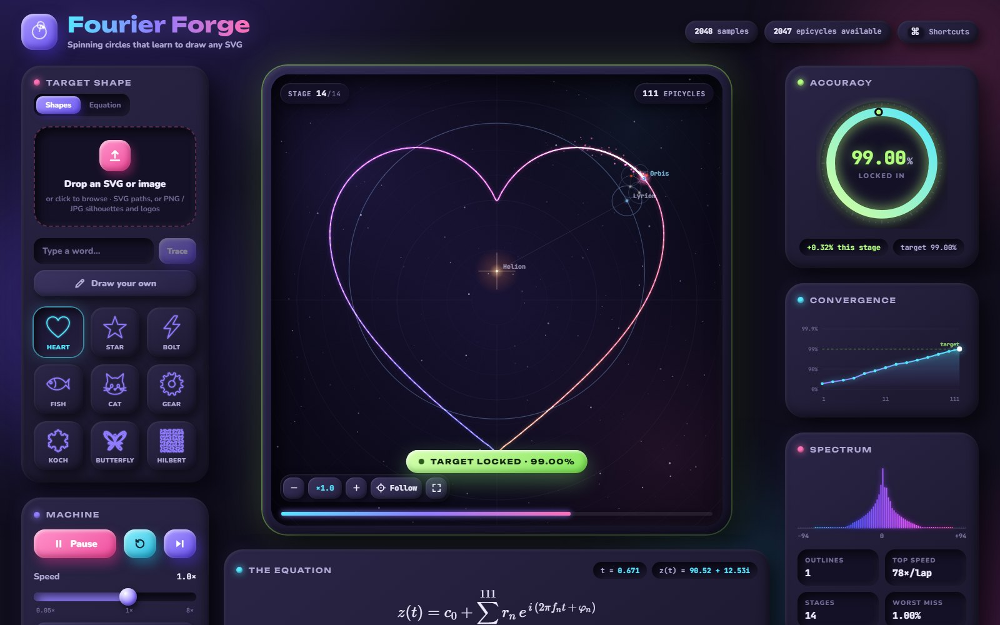
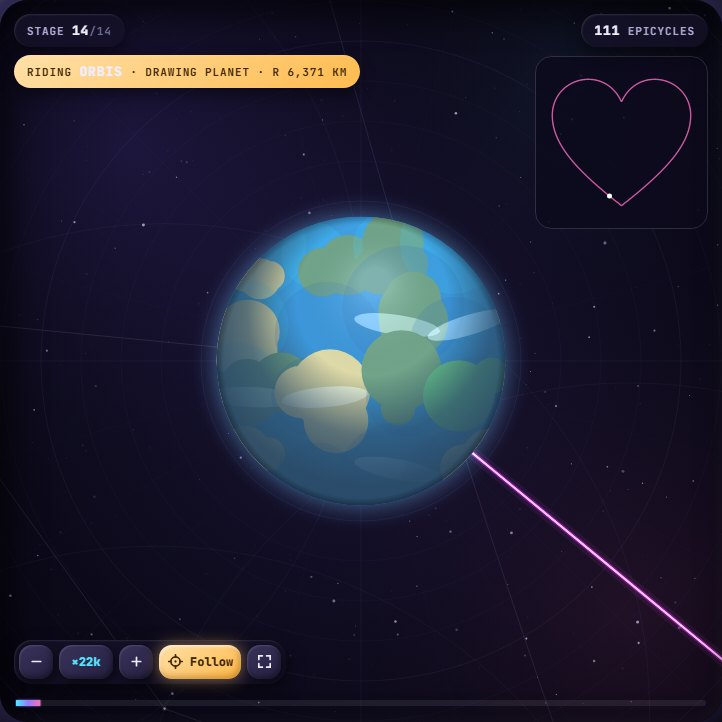
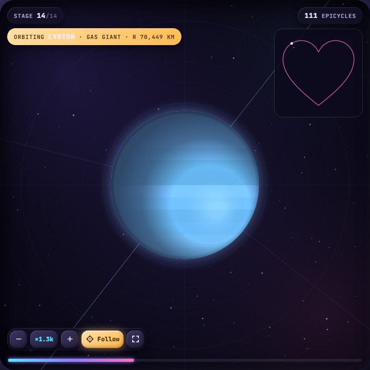
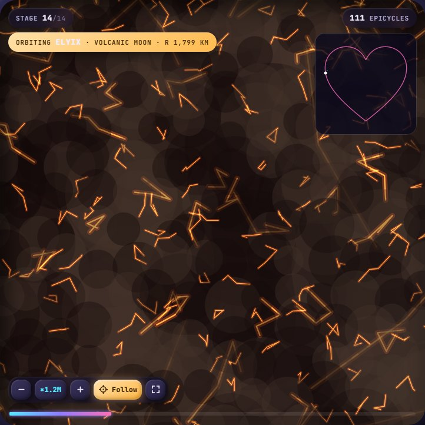

# Fourier Forge

**Spinning circles that learn to draw any shape — and a solar system you can dive into.**

Drop in an SVG (or an image, a word, or a sketch). Fourier Forge breaks its outline into a
Fourier series and redraws it with epicycles: one circle at first, then more and more, stage by
stage, until the drawing matches the target to the accuracy you choose. In the default *Cosmic*
look the circles become a star, planets and moons at realistic scale, and you can zoom from the
whole system down to the craters of a 10 km asteroid.



| Riding the drawing planet | A gas giant at ×1,300 | A volcanic moon at ×1.2M |
| --- | --- | --- |
|  |  |  |

## Features

**Drawing**
- Any target: SVG upload (paths, polygons, circles, transforms, multi-part shapes), PNG/JPG
  silhouettes, a typed word, or a freehand sketch. Nine built-in test shapes.
- Progressive run from 1 circle up to the accuracy target, with a live accuracy gauge,
  convergence chart and frequency spectrum.
- **Equation panel**: the series being drawn, typeset with its real coefficients, updated live.
- **Equation playground**: build your own series term by term (radius, speed, phase) and watch
  it draw — presets, randomise, or start from the biggest circles of any shape.
- Explorer: add or remove circles one at a time; circles ordered by size or by frequency.
- Error heatmap on the trail, ghost trails of earlier stages.

**Cosmos**
- The centre is a star, every joint a planet, moon or asteroid, the tip **Orbis** — the planet
  that draws the line.
- **Realistic scale**: true radii in km with the first orbit taken as 1 AU (planetarium-style
  markers when a world is smaller than a pixel), or **Enlarged** sizes for a readable overview.
- Procedural surfaces with detail at every zoom level: gas-giant bands and storms, continents
  and clouds, craters within craters, ice fractures, lava rifts, solar granulation.
- Click any world to fly to it; zoom from ×1 to ×1,000,000,000 with exact double-precision
  positioning.

**Playback**
- Speed 0.05×–8×, slow-mo, frame stepping, scrubbing, follow camera, minimap.
- Fullscreen with a control dock and the live equation overlay.
- Record the whole run as a video (MP4 or WebM).

## Getting started

Requires Node.js 18+.

```bash
npm install
npm run dev
```

Then open http://localhost:5173. `npm run build` produces a static site in `dist/`.

## Controls

| Key | Action |
| --- | --- |
| Space | Play / pause |
| ← → | Step through the lap |
| R / S | Restart / skip to the final stage |
| [ ] | One circle fewer / more |
| F | Follow the drawing planet |
| C | Fullscreen |
| E | Equation overlay (fullscreen) |
| Shift (hold) | Slow-mo |
| + − 0 | Zoom in / out / reset |
| Wheel, drag, double-click | Zoom at cursor, pan, reset view |
| Click a world | Fly to it |

## How it works

1. **Trace** — the SVG is parsed into polylines (own path parser: arcs, relative commands,
   transforms). Separate outlines are stitched into one loop along a minimum spanning tree, each
   bridge walked out and back so it reads as a hairline. Images and text are traced with
   marching squares.
2. **Transform** — the loop is resampled to 2048 evenly spaced points and run through an FFT.
   Each coefficient is one circle: radius `r`, `f` turns per lap, starting angle `φ`.
3. **Draw** — circles are added in order of size (or frequency) in a geometric ladder of stages
   until the target accuracy is reached.
4. **Accuracy** — `1 − (worst distance between the curve and the target) ÷ (RMS radius of the
   shape)`. Deliberately strict: one bad corner keeps it below 100%.

Built with React 19 and Vite, rendered on a 2D canvas, equations typeset with KaTeX.

## Project layout

```
src/
  lib/fourier.js      FFT, analysis, accuracy, stage schedule
  lib/svgSampler.js   SVG → one closed loop of samples
  lib/traceRaster.js  images and text → outlines (marching squares)
  lib/engine.js       canvas renderer, camera, deep zoom
  lib/cosmos.js       stars, planets, moons and their procedural surfaces
  components/         panels, controls, playground, fullscreen dock
public/samples/       the built-in shapes as SVG files, handy for testing uploads
```
